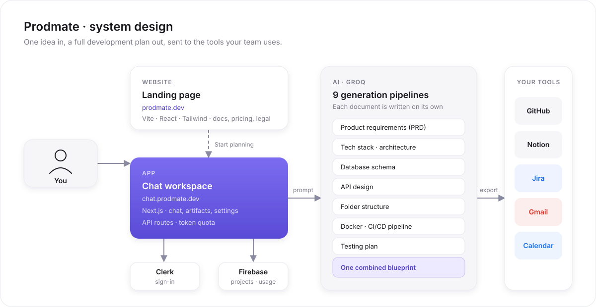

# Prodmate

Turn a software idea into a full development plan, then send it to GitHub, Jira, Notion, Gmail and Google Calendar.

**Website:** [prodmate.dev](https://prodmate.dev) · **App:** [chat.prodmate.dev](https://chat.prodmate.dev) · **Docs:** [prodmate.dev/docs](https://prodmate.dev/docs)



## What it does

1. You describe your product in plain words.
2. Prodmate writes nine documents at once: PRD, tech stack, database schema, API design, folder structure, Docker, CI/CD, testing plan and one combined blueprint.
3. You refine them in chat and export them to your tools.

Prodmate is free while it's in beta. Everything else, from features to integrations, is explained on the [website](https://prodmate.dev) and in the [docs](https://prodmate.dev/docs).

## Repository

| Folder          | What it is                    | Stack                      |
| --------------- | ----------------------------- | -------------------------- |
| `landing-page/` | The website at prodmate.dev   | Vite, React, Tailwind      |
| `chat-page/`    | The app at chat.prodmate.dev  | Next.js, Clerk, Firebase, Groq |

## Run it locally

```bash
# Website on http://localhost:3000
cd landing-page && npm install && npm run dev

# App on http://localhost:3001
cd chat-page && cp .env.example .env.local   # then fill in the keys
npm install && npm run dev -- -p 3001
```

Or run both with Docker: `docker compose -f docker-compose.dev.yml up --build`.

## Team

Built by **Team Hustler's** for the *Ship to Get Hired, Gappy AI Hackathon*: Krish Gupta, Sahil Mishra and Chandrika Pandey.

## License

MIT
